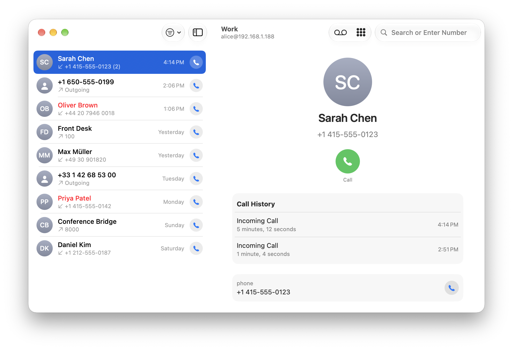
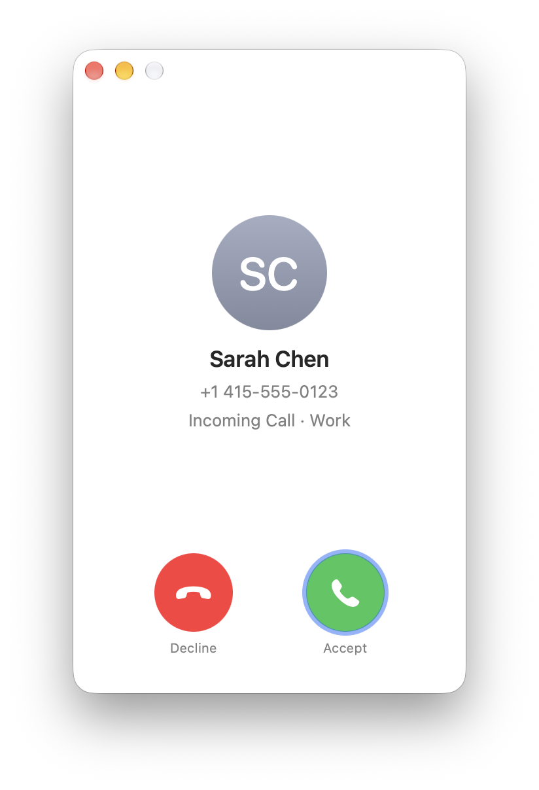
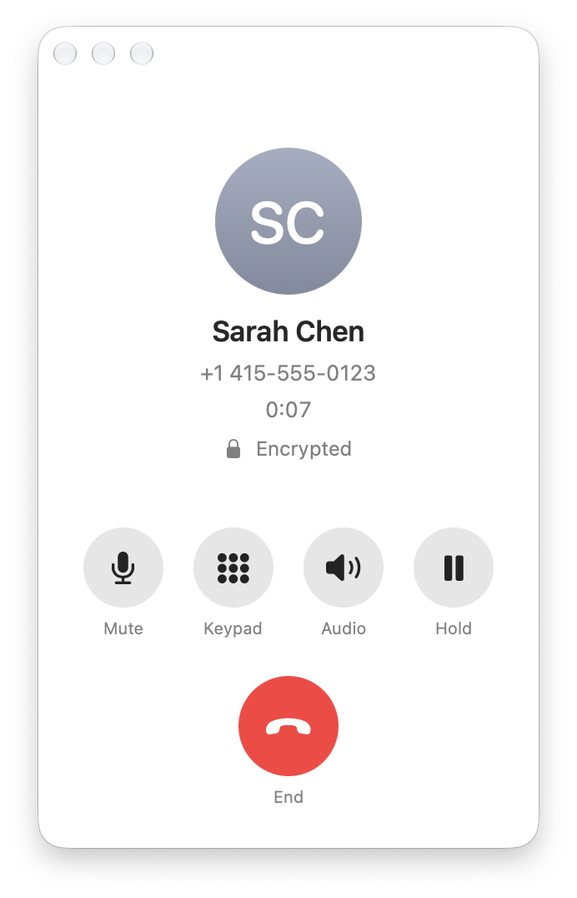
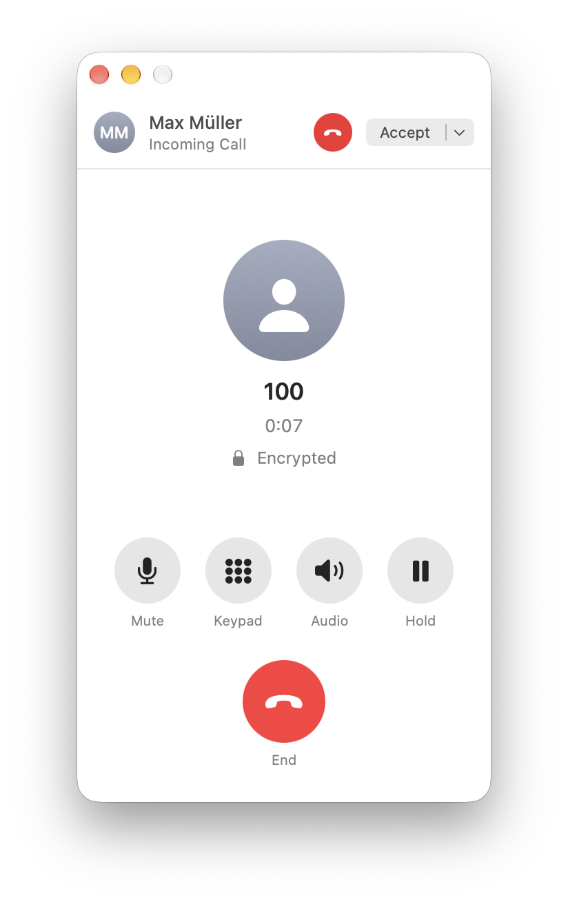
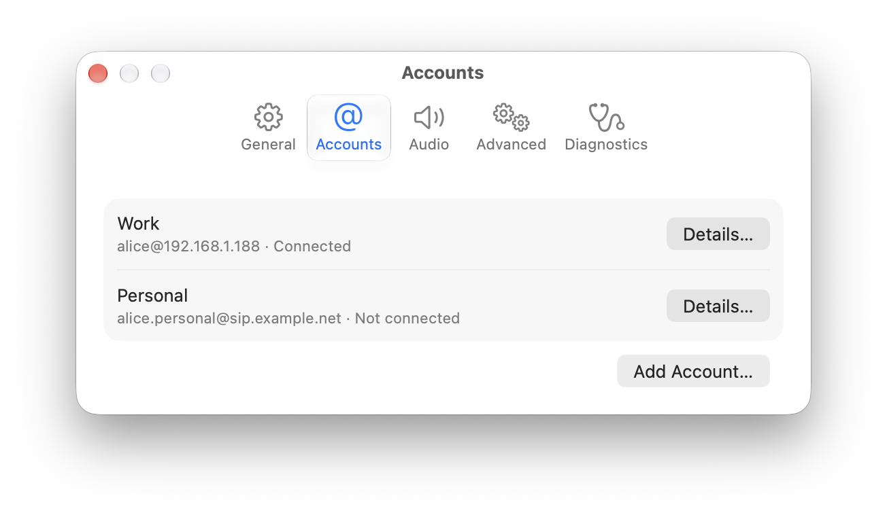
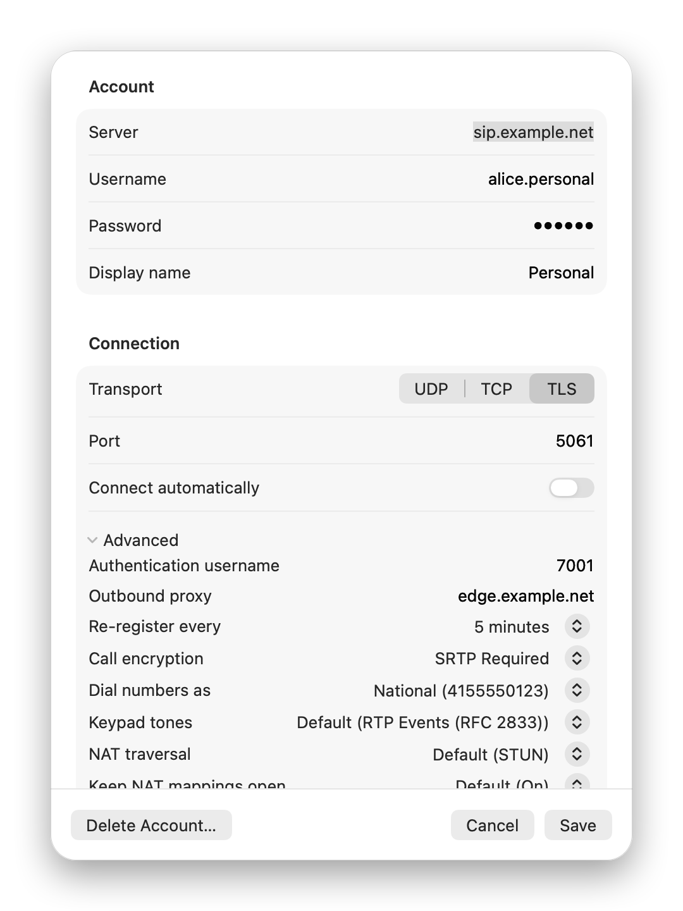
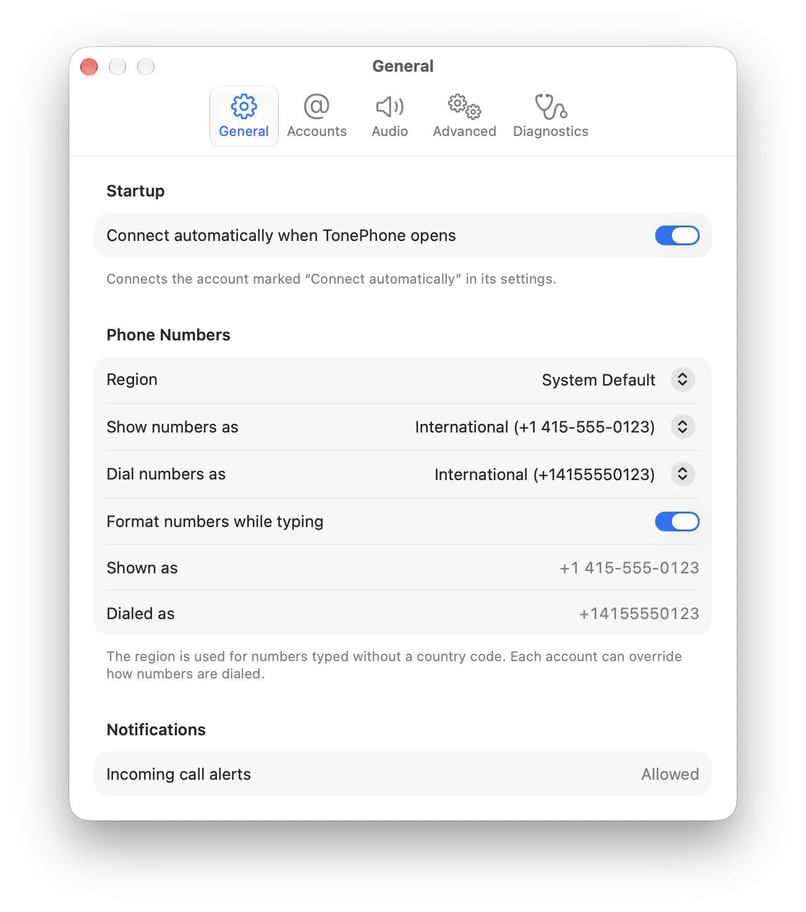
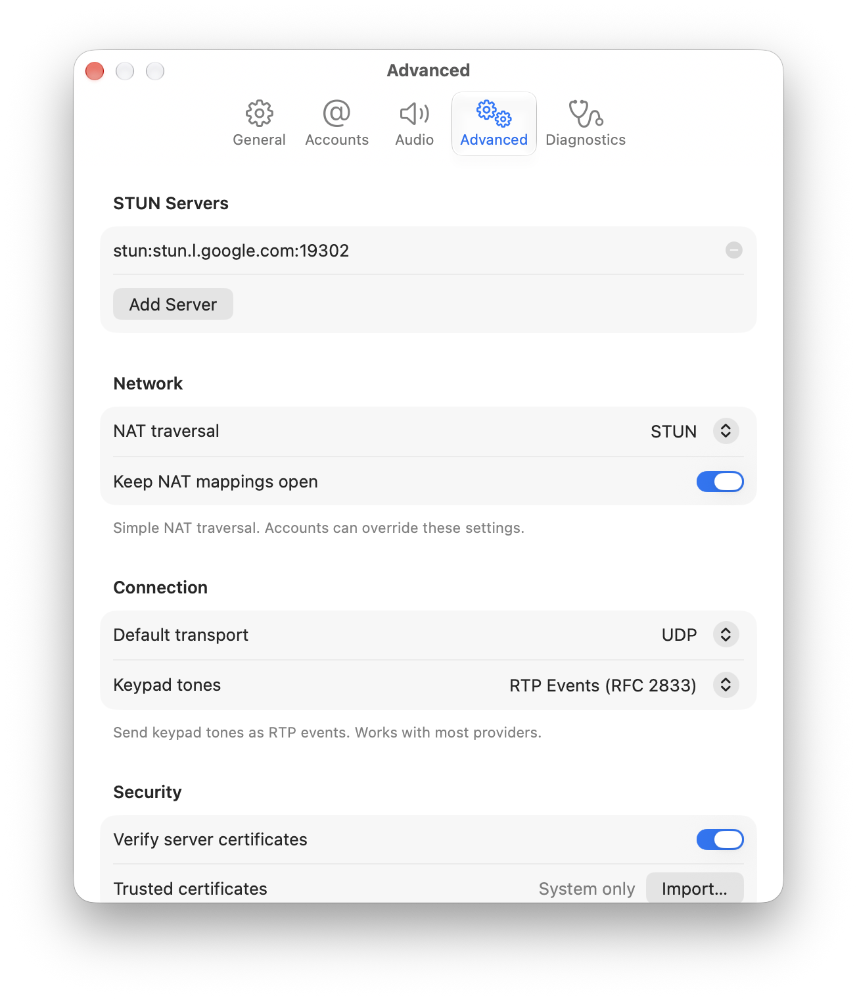
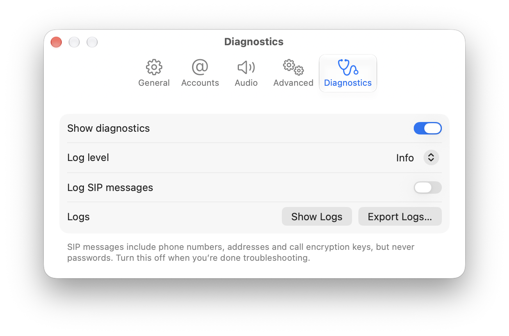
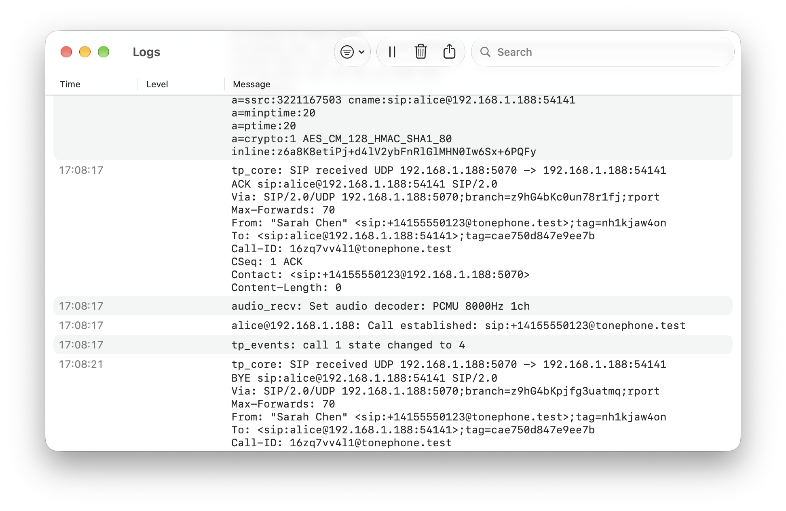

# TonePhone

A minimal, native SIP softphone for macOS.

<p align="center">
  
</p>
<p align="center">
  
  
  
</p>

---

## What It Is

TonePhone is a SIP softphone built on [baresip](https://github.com/baresip/baresip). It provides a clean, native SwiftUI interface for making and receiving voice calls over SIP, following Apple's Human Interface Guidelines.

macOS is the primary platform. The C bridge and core libraries also build for iOS; an iOS app is planned.

## Features

- **Calls:** a separate call window like the Phone app; make, accept, decline, hold, mute, keypad tones (RFC 2833, SIP INFO or automatic); call waiting with Hold & Accept, End & Accept and Swap; a lock shows when the audio is encrypted
- **Voicemail:** voicemail number per account, new-message count in the toolbar and on the Dock icon
- **Incoming calls:** call window with Return to accept and Esc to decline; when TonePhone is in the background, a notification with Accept and Decline and a bouncing Dock icon (it never steals focus)
- **Accounts:** UDP, TCP or TLS with certificate verification (system certificates plus your provider's own CA), custom port, authentication username, outbound proxy, registration interval, SRTP / DTLS-SRTP call encryption, STUN/ICE, per-account overrides; clear connection errors ("The username or password is incorrect.")
- **Phone numbers:** choose how numbers are shown (international, national, compact, as received) and how they are dialed (international with or without plus, international prefix, national, as typed), per region and per account
- **Recents:** per-account call history grouped like the Phone app, All Calls / Missed filter, search that also dials what you type, keypad popover (⌘K), switch accounts from the window title
- **Audio:** pick speaker and microphone, live input level meter, ringtone choice
- **Diagnostics:** log viewer with search and filters, optional SIP message tracing (credentials redacted), log export
- **Reliability:** reconnects after sleep and network changes, unregisters cleanly on quit, keeps running in the background so calls still ring

## Screenshots

| Accounts | Account settings | Phone number settings |
|---|---|---|
|  |  |  |

| Advanced settings | Diagnostics |
|---|---|
|  |  |



## Who It's For

- Telecom engineers who need a reliable SIP client for daily use
- Developers working with SIP infrastructure
- Technical users who want a simple, predictable phone app
- Anyone tired of bloated VoIP clients

## Project Status

The macOS app is usable day to day with standards-compliant SIP providers. Expect rough edges; please report them. See [ROADMAP.md](ROADMAP.md) for what is done and what is next.

## Design Philosophy

TonePhone follows the [Apple Human Interface Guidelines](https://developer.apple.com/design/human-interface-guidelines/). Native system controls are preferred over custom implementations. See [UI_GUIDELINES.md](UI_GUIDELINES.md) for the detailed rules.

## Architecture

```
┌─────────────────────────────────────┐
│           App (SwiftUI)             │  ← macOS frontend
├─────────────────────────────────────┤
│         TonePhone Bridge            │  ← C API + Swift wrapper
├─────────────────────────────────────┤
│        Baresip Core (C)             │  ← SIP, RTP, codecs, NAT, encryption
└─────────────────────────────────────┘
```

Key principle: **UI never touches SIP internals directly.**

The bridge exposes a small C API (`tp_*` functions) that Swift calls. baresip runs on its own thread; every bridge call into it holds the libre lock, and events are delivered to the UI on the main thread in order.

See [ARCHITECTURE.md](ARCHITECTURE.md) for details.

## Building

Requirements:
- macOS 14 or later with Xcode 15 or later to build (the app runs on macOS 13 and later)
- CMake, Ninja and pkg-config (`brew install cmake ninja pkg-config`)

```bash
git clone --recursive https://github.com/falseinteger/TonePhone.git
cd TonePhone
./scripts/build-openssl.sh
./scripts/build-opus.sh
./scripts/build-core.sh
./scripts/package-xcframework.sh
open apps/macOS/TonePhone.xcodeproj
```

TonePhone uses baresip and libre **4.12.0**. Fixes not yet upstream are applied from [core/patches](core/patches/README.md) at build time.

See [BUILDING.md](BUILDING.md) for complete instructions.

### Trying it without a SIP provider

`scripts/dev-sip-server.py` is a tiny registrar and call peer for local testing:

```bash
./scripts/dev-sip-server.py --user alice --password secret
```

Add an account with the address it prints, port 5070, UDP, user `alice`, password `secret`. Type `call` in the server's terminal to ring TonePhone, `cancel` for a missed call, `bye` to hang up, `voicemail 3` to report new voicemail. Calls you place from TonePhone are answered automatically.

## Contributing

Contributions are welcome. Please read [CONTRIBUTING.md](CONTRIBUTING.md) before opening issues or pull requests.

## Non-Goals

TonePhone is intentionally limited. The following are explicitly out of scope:

- **Video calls** — This is an audio-only client
- **Instant messaging / chat** — Use a messaging app
- **Presence / buddy lists** — Not a social platform
- **Enterprise features** — No provisioning, no LDAP, no BLF arrays
- **Cloud sync** — Local-only by design
- **Support for every SIP provider** — Works with standards-compliant servers
- **Cross-platform beyond Apple** — macOS and iOS only
- **Maximum feature count** — Simplicity is a feature

## License

TonePhone source code is licensed under [MIT](LICENSE).

Third-party dependencies (baresip, libre, OpenSSL, Opus, PhoneNumberKit) are licensed under BSD-3-Clause, Apache-2.0 or MIT. See [THIRD_PARTY_LICENSES.md](THIRD_PARTY_LICENSES.md) for details; the app shows them under Help › Acknowledgements.

## Related

- [baresip](https://github.com/baresip/baresip) — The SIP engine (BSD-3-Clause)
- [libre](https://github.com/baresip/re) — baresip's core library, including librem (BSD-3-Clause)
